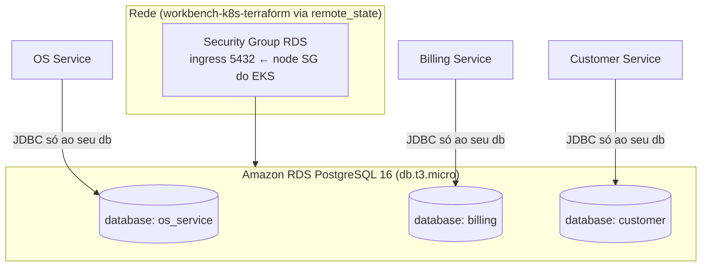
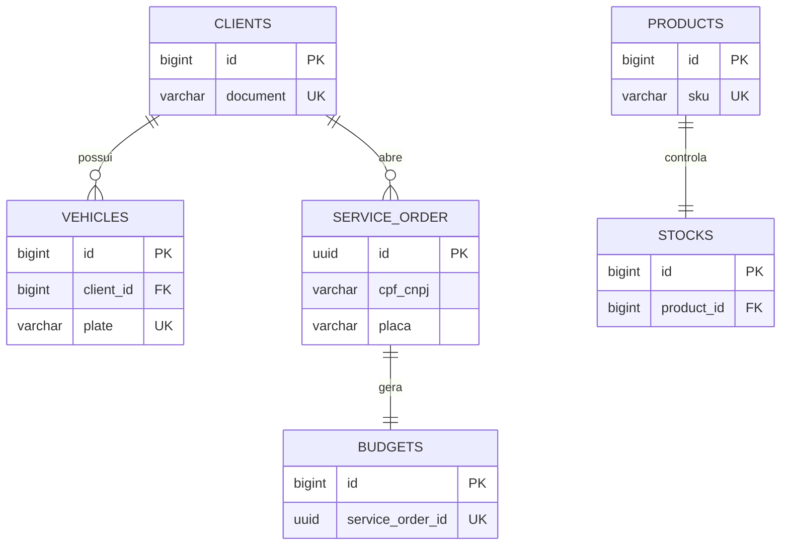

# workbench-database

Infraestrutura do **banco de dados relacional gerenciado** (Amazon RDS PostgreSQL)
da plataforma Workbench — Tech Challenge FIAP Pós Tech.

> **Contexto (Fase 4):** este repositório nasceu na Fase 3 para prover o **RDS
> PostgreSQL** do monólito (`workbench-monolith`). Na Fase 4 a aplicação foi
> refatorada em **microsserviços**, e o requisito passou a ser **um banco próprio
> por serviço**, com **isolamento** (nenhum serviço acessa o banco de outro). Leia a
> seção [Papel na arquitetura de microsserviços](#papel-na-arquitetura-de-microsserviços)
> para entender o que mudou e como este repo se encaixa agora.

---

## Papel na arquitetura de microsserviços

Na Fase 4, **cada microsserviço é dono do seu banco** e cria/versiona o próprio
schema com **Flyway** (migrations dentro de cada serviço) — não há mais um schema
central. A distribuição de bancos é:

| Serviço | Banco | Schema |
|---|---|---|
| OS Service | PostgreSQL | Flyway no `workbench-os-service` |
| Billing Service | PostgreSQL | Flyway no `workbench-billing-service` |
| Customer Service | PostgreSQL | Flyway no `workbench-customer-service` |
| Execution Service | **MongoDB** (NoSQL) | no `workbench-execution-service` |

Portanto, este repositório **provisiona a instância RDS PostgreSQL** que hospeda os
bancos dos serviços **SQL** (OS, Billing, Customer) — cada um em seu **database
lógico isolado** dentro da instância, com credenciais próprias. O **isolamento**
exigido pelo PDF é garantido porque cada serviço só conhece a URL/credencial do seu
próprio database; ninguém lê as tabelas do outro. O **MongoDB** do Execution é
provisionado à parte (serviço gerenciado / container), fora deste repo.

> Alternativa possível (não adotada por custo no Learner Lab): uma instância RDS
> por serviço. Optou-se por **uma instância compartilhada com databases lógicos
> isolados**, que cumpre o isolamento lógico exigido pelo PDF a um custo viável.

### ⚠️ Sobre o schema histórico (`scripts/ddl.sql`)

O `scripts/ddl.sql` contém o **schema monolítico da Fase 3** (todas as tabelas no
mesmo banco). Ele é mantido apenas como **referência histórica** do monólito. Na
Fase 4 **não é a fonte da verdade** — cada microsserviço define seu próprio schema
por Flyway. O diagrama ER ao final deste documento descreve esse schema histórico.

---

## Tecnologias

- **PostgreSQL 16** (Amazon RDS, `db.t3.micro`)
- **Terraform** (`~> 5.0` AWS provider) — RDS, security group e subnet group
- **GitHub Actions** — CI (`terraform fmt`/`validate`) e CD (deploy do RDS)
- Backend de estado remoto: **S3**

## Arquitetura deste repositório



O RDS **não é acessível publicamente** — o Security Group libera a porta 5432 apenas
para o `node_security_group_id` do EKS (lido via `terraform_remote_state` do
`workbench-k8s-terraform`), de modo que só os pods dos serviços (na mesma VPC)
alcancem o banco.

---

## Justificativa do PostgreSQL

Formalizada em
[`workbench-monolith/docs/rfc/RFC-0002-escolha-banco-dados.md`](../workbench-monolith/docs/rfc/RFC-0002-escolha-banco-dados.md).
Resumo: domínio fortemente relacional (OS, orçamento, cadastro) com transações ACID,
campos semiestruturados em `JSONB` quando necessário, e custo coberto pelo Learner Lab.
O requisito **NoSQL** do PDF é atendido pelo MongoDB do Execution Service.

---

## Deploy

```bash
cd infra/terraform
cp terraform.tfvars.example terraform.tfvars   # preencha os valores reais

terraform init \
  -backend-config="bucket=<state-bucket>" \
  -backend-config="key=database/<env>/terraform.tfstate" \
  -backend-config="region=us-east-1"

terraform apply   # provisiona o RDS e cria o database informado em var.db_name
```

Após o `apply`, o output `aurora_jdbc_url` é a base da URL JDBC; cada serviço recebe,
no seu secret `DB_URL_<ENV>`, a URL apontando para o **seu** database lógico.

### Credenciais

Secrets `DB_USERNAME` e `DB_PASSWORD` no GitHub Actions. O usuário não pode ser
`postgres` (reservado pelo RDS) — use, por exemplo, `dbadmin`. Cada serviço deve ter
seu usuário/credencial próprios para reforçar o isolamento.

## Ordem de deploy (infra)

```
workbench-k8s-terraform → workbench-database → workbench-lambda → workbench-gateway → microsserviços
```

---

## Anexo — Diagrama ER (schema HISTÓRICO do monólito, Fase 3)

> Mantido apenas como referência. Na Fase 4, estas tabelas estão **distribuídas**
> entre os bancos dos serviços (clientes/veículos no Customer; OS/serviços no OS;
> orçamento no Billing; estoque/produtos no Execution/Mongo).



Schema completo em [`scripts/ddl.sql`](scripts/ddl.sql). Ajustes de integridade
(FKs/índices/CHECK) propostos em [`scripts/ddl-improvements.sql`](scripts/ddl-improvements.sql).

---

## Notas

- Adicionar o usuário **`soat-architecture`** como colaborador (requisito de entrega).
