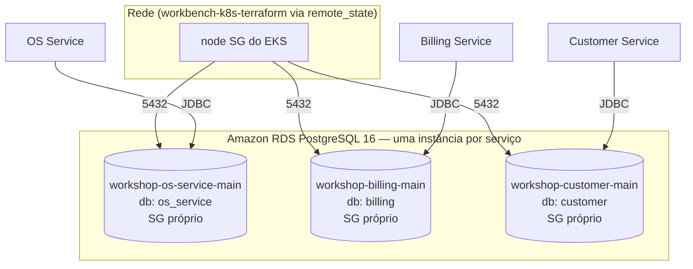
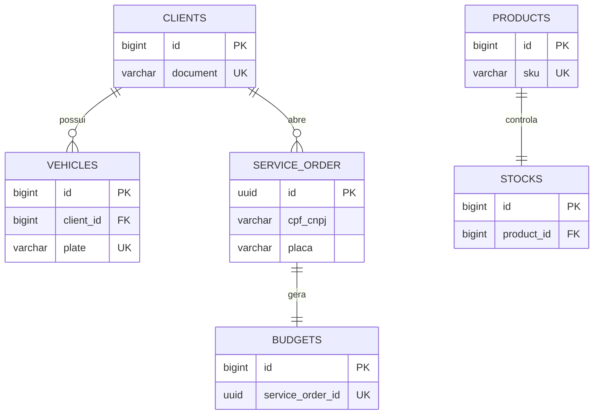

# workbench-database

Infraestrutura do **banco de dados relacional gerenciado** (Amazon RDS PostgreSQL)
da plataforma Workbench — Tech Challenge FIAP Pós Tech.

> **Contexto (Fase 4):** este repositório nasceu na Fase 3 para prover o **RDS
> PostgreSQL** do monólito (`workbench-monolith`). Na Fase 4 a aplicação foi
> refatorada em **microsserviços**, e o requisito passou a ser **um banco próprio
> por serviço**, com **isolamento** (nenhum serviço acessa o banco de outro). Leia a
> seção [Papel na arquitetura de microsserviços](#papel-na-arquitetura-de-microsserviços)
> para entender o que mudou e como este repo se encaixa agora.

---

## Papel na arquitetura de microsserviços

Na Fase 4, **cada microsserviço é dono do seu banco** e cria/versiona o próprio
schema com **Flyway** (migrations dentro de cada serviço) — não há mais um schema
central. A distribuição de bancos é:

| Serviço | Banco | Schema |
|---|---|---|
| OS Service | PostgreSQL | Flyway no `workbench-os-service` |
| Billing Service | PostgreSQL | Flyway no `workbench-billing-service` |
| Customer Service | PostgreSQL | Flyway no `workbench-customer-service` |
| Execution Service | **MongoDB** (NoSQL) | no `workbench-execution-service` |

Portanto, este repositório **provisiona uma instância RDS PostgreSQL dedicada para
cada serviço SQL** (OS, Billing, Customer). Cada instância tem **banco, credencial
master, endpoint e security group próprios** — nada é compartilhado entre serviços.
O isolamento é **físico**: uma instância não alcança os dados da outra por construção,
atendendo literalmente o requisito do PDF ("cada microsserviço com banco de dados
próprio" e "nenhum serviço pode acessar diretamente o banco de outro"). O **MongoDB**
do Execution é provisionado à parte (serviço gerenciado / container), fora deste repo.

| Serviço | Instância RDS (`main`) | Database | Credencial |
|---|---|---|---|
| OS Service | `workshop-os-service-main` | `os_service` | própria |
| Billing Service | `workshop-billing-main` | `billing` | própria |
| Customer Service | `workshop-customer-main` | `customer` | própria |

> Cada instância é criada pelo módulo `modules/rds-instance`, instanciado uma vez por
> serviço via `for_each` sobre a variável `services`. Os nomes dos databases casam com
> o `SPRING_DATASOURCE_URL` de cada serviço (ex.: `jdbc:postgresql://<endpoint-os>:5432/os_service`).
> As senhas vêm da variável sensível `service_passwords` (injetada por secret no CI;
> nunca commitada).

> **Custo:** três instâncias `db.t3.micro` elegíveis ao free tier. Antes optou-se por
> uma única instância com databases lógicos; a versão atual usa **uma instância por
> serviço** para cumprir o requisito do PDF de forma literal (banco próprio por serviço).

### ⚠️ Sobre o schema histórico (`scripts/ddl.sql`)

O `scripts/ddl.sql` contém o **schema monolítico da Fase 3** (todas as tabelas no
mesmo banco). Ele é mantido apenas como **referência histórica** do monólito. Na
Fase 4 **não é a fonte da verdade** — cada microsserviço define seu próprio schema
por Flyway. O diagrama ER ao final deste documento descreve esse schema histórico.

---

## Tecnologias

- **PostgreSQL 16** (Amazon RDS, `db.t3.micro`) — **uma instância por serviço**
- **Terraform** (`~> 5.0` AWS provider) — módulo `rds-instance` (RDS + security group + subnet group), instanciado por serviço
- **GitHub Actions** — CI (`terraform fmt`/`validate`) e CD (deploy das instâncias)
- Backend de estado remoto: **S3**

## Arquitetura deste repositório



Cada instância **não é acessível publicamente** (`publicly_accessible = false`,
default) — o Security Group de cada uma libera a porta 5432 apenas para o
`node_security_group_id` do EKS (lido via `terraform_remote_state` do
`workbench-k8s-terraform`), de modo que só os pods dos serviços (na mesma VPC)
alcancem o banco. CIDRs adicionais podem ser liberados via `allowed_cidr_blocks`
(vazio por padrão). Não há regra `0.0.0.0/0`.

Cada instância tem **criptografia em repouso** (`storage_encrypted = true`, sem custo
adicional) e **backups automáticos** (`backup_retention_period = 1` dia por padrão,
ajustável de 0 a 35). O padrão é 1 porque contas no plano Free da AWS rejeitam valores
maiores (`FreeTierRestrictionError`); em conta paga, suba para 7 via variável.

A rede (VPC, subnets privadas e node SG) é resolvida do estado remoto do
`workbench-k8s-terraform` quando `k8s_remote_state_bucket` é informado; caso contrário,
cai nos valores passados em `vpc_id`/`subnet_ids` (compatível com o CI atual, que os
injeta por secret).

---

## Justificativa do PostgreSQL

Formalizada em
[`workbench-monolith/docs/rfc/RFC-0002-escolha-banco-dados.md`](../workbench-monolith/docs/rfc/RFC-0002-escolha-banco-dados.md).
Resumo: domínio fortemente relacional (OS, orçamento, cadastro) com transações ACID,
campos semiestruturados em `JSONB` quando necessário, e custo coberto pelo Learner Lab.
O requisito **NoSQL** do PDF é atendido pelo MongoDB do Execution Service.

---

## Deploy

```bash
cd infra/terraform
cp terraform.tfvars.example terraform.tfvars   # preencha services + service_passwords

terraform init \
  -backend-config="bucket=<state-bucket>" \
  -backend-config="key=workbench-database/<env>/terraform.tfstate" \
  -backend-config="region=us-east-1"

terraform apply   # provisiona UMA instância RDS por serviço
```

Após o `apply`, o output `service_jdbc_urls` (sensível) traz um mapa
`serviço -> URL JDBC`, cada um apontando para a **sua instância dedicada**; é a base
do secret `DB_URL_<ENV>` de cada microsserviço. Veja também `instance_endpoints`,
`instance_identifiers` e `service_databases`.

```bash
terraform output -json service_jdbc_urls   # { "os_service": "...", "billing": "...", "customer": "..." }
```

### Credenciais

Cada instância tem **usuário e senha próprios**, definidos em `services[*].db_username`
e `service_passwords[*]`. O usuário não pode ser `postgres`/`admin`/`root`/`rdsadmin`
(reservados pelo RDS). No CI, as senhas vêm dos secrets `DB_PASSWORD_OS`,
`DB_PASSWORD_BILLING` e `DB_PASSWORD_CUSTOMER` (e, opcionalmente, `DB_USERNAME_*`); são
injetadas via `TF_VAR_service_passwords` e nunca gravadas em arquivo. Como são
instâncias separadas, a credencial de um serviço **não dá acesso** ao banco de outro.

## Ordem de deploy (infra)

```
workbench-k8s-terraform → workbench-database → workbench-lambda → workbench-gateway → microsserviços
```

---

## Anexo — Diagrama ER (schema HISTÓRICO do monólito, Fase 3)

> Mantido apenas como referência. Na Fase 4, estas tabelas estão **distribuídas**
> entre os bancos dos serviços (clientes/veículos no Customer; OS/serviços no OS;
> orçamento no Billing; estoque/produtos no Execution/Mongo).



Schema completo em [`scripts/ddl.sql`](scripts/ddl.sql). Ajustes de integridade
(FKs/índices/CHECK) propostos em [`scripts/ddl-improvements.sql`](scripts/ddl-improvements.sql).

---

## Notas

- Adicionar o usuário **`soat-architecture`** como colaborador (requisito de entrega).
